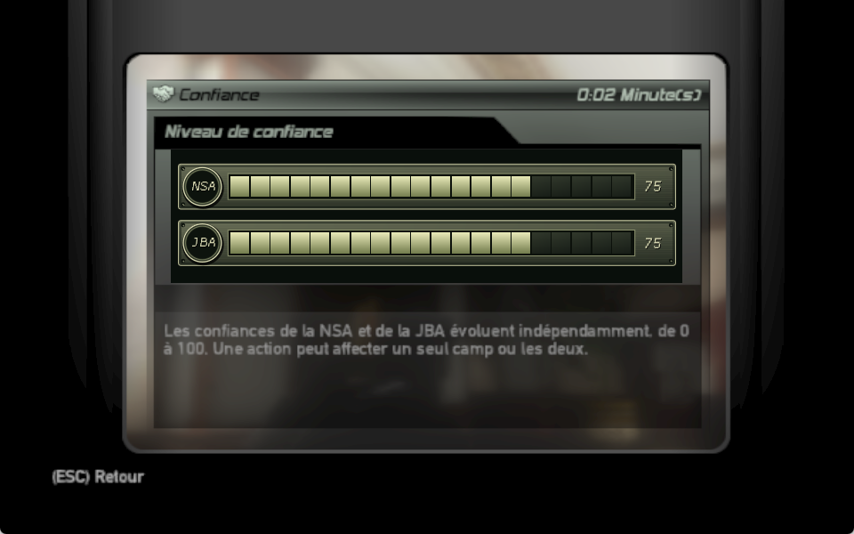
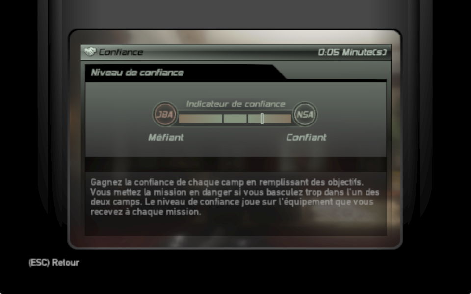
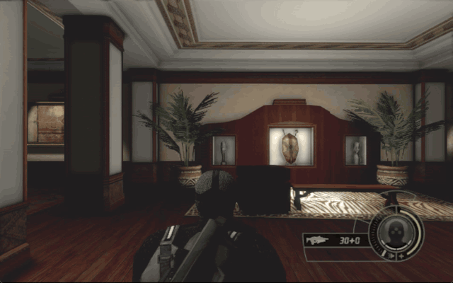
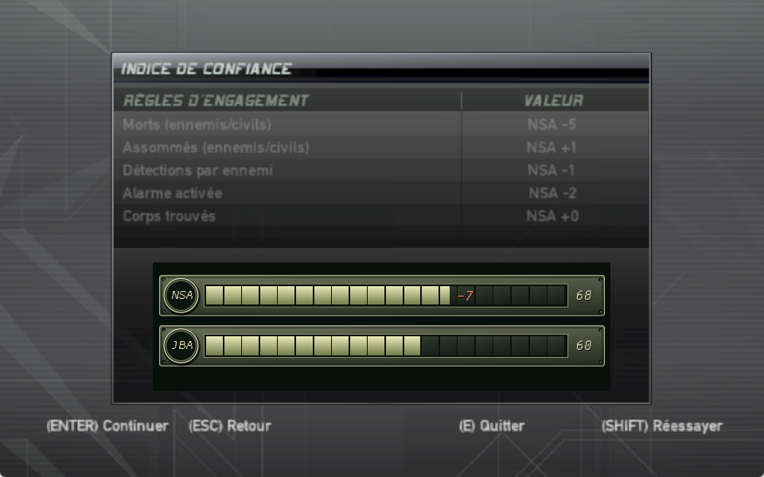

# Double Agent B — Dual Trust Mod

**Two allegiances. Two independent trust meters.**

A single-player gameplay mod for the **original Xbox version of Splinter Cell: Double Agent**, built on [TGP482’s SCDA-XBERecomp](https://github.com/TGP482/SCDA-XBERecomp). NSA and JBA trust are tracked separately: helping one faction no longer automatically hurts the other.

The dual-trust concept comes from **Double Agent version A (Xbox 360, PC and PS3)**. This mod brings that approach to **version B (original Xbox)**, with independent NSA/JBA effects adapted to version B’s campaign and objectives.

> **Campaign testing in progress.** The core system, checkpoint persistence and interface have been tested with native in-game calls. A complete campaign, every crisis branch and all endings have not yet been validated. Start with a backed-up save or a fresh campaign.



## Independent faction effects — updated alpha.1 and alpha.2

Equipment rewards now use each faction's own trust: **61+** qualifies for its kit.
If both qualify, their supplies are combined without doubling duplicate items;
if neither qualifies, the default kit applies. Elite loadouts keep their rules.
Trust-recovery entries on computers now follow the corresponding faction at
**40 or less**, including both when both are low. Mission-entry warnings also
use independent trust rather than assuming high NSA means low JBA.

Both existing downloads have been updated in place. Download again if you have
an earlier copy; keep your saves and matching `trust-state/` folder together.

**Balance:** alpha.1 retains its original gains, losses and statistics caps.
For the stronger rebalancing, use alpha.2.

## What changes

- **Two independent scores, from 0 to 100.** New mod state starts at 75 NSA / 75 JBA. Both can be high, both can be low, and an action can affect one faction or both.
- **Trust effects based on story context.** The 45 nonzero story rules are classified separately for each faction. Neutral objectives remain neutral, and opposite outcomes replace the credit for the previous choice.
- **Independent mission statistics.** Enabled rules for kills, knockouts, detection, alarms and discovered bodies affect NSA trust; they do not automatically reward the JBA.
- **An interface closer to the original.** Olive metallic faction strips, circular badges and ivory segmented meters replace the shared gauge in the OPSAT and mission review.
- **Temporary, animated notifications.** Only affected factions appear during gameplay. The meter moves from its previous value to the new score, the changed segments pulse, and a signed delta appears just beyond the new fill level before fading. There is no constant debug panel.
- **Checkpoint persistence.** Both scores and the event ledger survive reloads, preventing an objective from rewarding the same action repeatedly.

## Before / after

<table>
  <tr>
    <th width="50%">Before: original shared meter</th>
    <th width="50%">After: independent faction meters</th>
  </tr>
  <tr>
    <td></td>
    <td></td>
  </tr>
</table>

The “before” image shows the game’s native trust presentation with the replacement presentation disabled in an isolated capture build. Screenshots use controlled test states to demonstrate the interface; they are not a matched campaign-outcome comparison. These are in-game captures, not the earlier generated design proposals.

| Original system | Dual Trust Mod |
| --- | --- |
| One shared balance between NSA and JBA | Two separately stored scores |
| A gain in one direction implies a loss in the other | Each action has independent NSA/JBA effects |
| A single combined trust indicator | Separate faction meters and affected-faction notifications |
| One scalar in the checkpoint | Original checkpoint plus versioned dual-trust metadata |

### Animated trust changes



A loss flashes the removed segment range in muted red; a gain highlights the added range in ivory-green. The notification lasts five seconds. Values are applied immediately—the animation only explains the change. At the edge of a full meter, the delta is kept inside the track so it remains readable.

### Mission review



The review retains the native rules table and previews each faction’s resulting trust independently, including score limits.

## Build and play

This branch contains the mod’s source. **An unmodified upstream release does not contain these changes.**

You need Windows 10 or later (64-bit), a Direct3D 12 GPU, and your own game files from the original Xbox release. This mod does not target the separate Xbox 360/PS3/PC version of Double Agent, and no game files are included.

1. Clone this fork:

   ```console
   git clone https://github.com/DaemonSnake/SCDA-B-dual-trust-mod.git
   cd SCDA-B-dual-trust-mod
   ```

2. Put your extracted game files in `assets/`: `default.xbe`, `sc4_adv.xbe`, and the `Default`, `Media` and `adv` folders. Building requires extracted files, not an ISO.
3. Install Visual Studio 2022 with **Desktop development with C++**, **C++ Clang tools for Windows**, and **C++ CMake tools for Windows**.
4. Run `build.bat`, then launch `out\build\release\SCDA.exe`. The initial build can take a while.
5. Start a new solo campaign for the clearest balance test. Open the OPSAT to inspect both scores; notifications appear only when trust changes.

The preserved [orginal_readme.md](orginal_readme.md) contains the upstream port’s full hardware requirements, graphics settings, controls, networking and build documentation. The filename is intentionally preserved as requested.

## Saves and compatibility

Back up your save directory before testing. **Keep the `trust-state/` directory beside the executable together with your saves** when moving or backing up a modded installation: it contains both scores and credited events.

Retail checkpoint bytes retain their original format. A checkpoint without mod metadata imports the old scalar as `NSA = x`, `JBA = 100 − x`; its earlier independent history cannot be reconstructed. A new campaign is preferable for testing the intended balance.

The mod targets solo play. Co-op and versus retain their existing behavior; full multiplayer regression testing has not been completed. To return to upstream, use an unmodified build with a separate backup of your pre-mod saves. Upstream cannot recover the independent JBA history from the mod’s metadata.

## Current limits and useful bug reports

- Full campaign validation remains open, including trust crises, timers, equipment rewards and endings. Some original scripts still directly read the legacy scalar.
- Discovery of bomb sabotage currently applies the deferred JBA penalty at mission exit. The exact discovery moment needs further campaign work.
- A protected police officer recorded by the game as an enemy cannot yet be distinguished from other enemy records in the generic statistics.
- Native profile history still uses the original scalar format. The current mission review is independent; historical profile charts are not converted to two histories.

Please [open an issue](https://github.com/DaemonSnake/SCDA-B-dual-trust-mod/issues) with the mission/checkpoint, action or choice, scores before and after, expected behavior and a screenshot. Mention whether the campaign began on this mod or was imported from an older save. The detailed narrative rule reference contains story spoilers.

## Design and technical reference

- [Narrative rules and balance reference](knowledge/TRUST_REFERENCE.md) — **story spoilers**.
- [Implementation, verification and remaining limits](knowledge/TRUST_IMPLEMENTATION.md).
- [Structured rule catalogue](knowledge/TRUST_RULES_REFERENCE.json).
- [Original trigger inventory](knowledge/TRUST_TRIGGER_INVENTORY.md).

## Credits and license

- **Gameplay inspiration:** the independent NSA/JBA trust meters from Double Agent version A (Xbox 360, PC and PS3).
- **Mod direction and testing:** [DaemonSnake](https://github.com/DaemonSnake).
- **Native PC port:** [TGP482/SCDA-XBERecomp](https://github.com/TGP482/SCDA-XBERecomp), built with [Xbox XBE Recomp](https://github.com/TGP482/XboxXBE-Recomp). See the [preserved upstream README](orginal_readme.md) and [LICENSE](LICENSE) for the original project and attribution.
- **AI assistance:** OpenAI Codex assisted with reverse engineering, implementation, documentation and test automation. The visual direction was explored with AI-generated concepts; the shipped meters are drawn procedurally, and the screenshots above show the running game.
- Splinter Cell and its game assets belong to their respective owners. This is an unofficial fan project. The repository’s code remains under the [MIT license](LICENSE); game assets are not distributed here.
